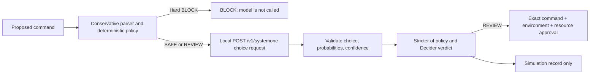

# OpsGuard

OpsGuard is a local, **simulation-only** DevSecOps command-safety dashboard. It never invokes a shell, cloud SDK, Kubernetes client, database driver, or infrastructure operation. A deterministic policy supplies a hard safety floor; a local Strands Decider classification can make a result stricter but can never downgrade it.

## Setup and run

```bash
cd ~/cybershield-ai
source .venv/bin/activate
pip install -r requirements.txt
python -m pytest -q
streamlit run app.py
```

Open the local Streamlit URL it prints. Try `kubectl get pods -n production` (SAFE), `kubectl apply -f deployment.yaml` (REVIEW), and `rm -rf /` (BLOCK).

## Deployment on Render

This repository includes a Render Blueprint in `render.yaml`:

- **Runtime:** Python 3.12.15 (`runtime.txt`)
- **Build command:** `pip install -r requirements.txt`
- **Start command:** `streamlit run app.py --server.address 0.0.0.0 --server.port $PORT`
- **Health check:** `/_stcore/health`
- **Plan:** free
- **Audit location in Render:** `/tmp/opsguard_audit.sqlite3`, selected with `OPSGUARD_DB_PATH`

To deploy, create a new Render **Blueprint** from this GitHub repository and accept `render.yaml`. No API keys, model downloads, cloud credentials, or Decider server are required to start the app. Leave `STRANDS_DECIDER_URL` unset unless you independently run a compatible, reachable Decider service; the default local endpoint is not a hosted production dependency.

### Live deployment

Not deployed yet. Add the verified public Render URL here only after deployment succeeds.

### Audit persistence caveat

Render's free filesystem is ephemeral. Audit records stored in `/tmp/opsguard_audit.sqlite3` can disappear after a restart, redeploy, or instance replacement. This prototype does **not** provide persistent or tamper-evident audit storage. The safe next step for persistent production audit history is an approved managed database or append-only logging service with access controls; no paid storage is configured by this project.

## Dashboard

- **Security Overview:** real counts from the local audit database, risk distribution, Decider state, and recent events.
- **Command Playground:** evaluates commands, presents policy reasons, requires exact resource confirmation for REVIEW, and records simulations only.
- **Policy Details:** searchable rule metadata derived from the deterministic evaluator.
- **Audit Explorer:** filters local records by decision, environment, text, and date; exports filtered CSV.
- **System Status:** reports local capabilities and limitations without claiming cloud or cluster connectivity.

To capture a screenshot for documentation, run the dashboard locally, select **Security Overview**, and use the browser's screenshot tool. Do not include commands containing credentials in screenshots or demo data.

## Architecture



- `opsguard/safety_engine.py`: strict `shlex` parsing, explicit read-only allowlist, deterministic blocks, and fail-closed handling of shell syntax and unknown commands.
- `opsguard/decider_client.py`: `STRANDS_DECIDER_URL` client for the typed `POST /v1/systemone` `choice` response, including its documented class probabilities and confidence.
- `opsguard/decision_pipeline.py`: applies the hard deterministic floor, calls Decider only after that floor passes, and selects the strictest valid verdict.
- `opsguard/approval.py`: command fingerprinting plus exact environment/resource binding for REVIEW approvals.
- `opsguard/simulator.py`: creates messages only; it contains no process-execution call.
- `opsguard/audit.py`: parameterized SQLite event log (`opsguard_audit.sqlite3`) with backward-compatible environment/resource migration, filtering, metrics, and common secret-assignment redaction.
- `app.py`: enterprise-style Streamlit dashboard with sidebar navigation.

## Local Decider decision flow

For non-hard-blocked commands, OpsGuard asks the local Decider to choose exactly one of `safe`, `review`, or `block`. It accepts only a valid typed `choice` answer with all three probabilities summing to one and a documented `confidence` in `[0, 1]`. The displayed confidence is supplied by Decider; OpsGuard does not calibrate or manufacture it.

Set `STRANDS_DECIDER_URL` to configure the service (default `http://127.0.0.1:8099`) and run a compatible local Strands Decider server separately. If its optional API-key protection is enabled, set `STRANDS_DECIDER_API_KEY`; OpsGuard sends it only as a Bearer authorization header and never writes it to the audit log. The upstream command is:

```bash
~/cybershield-ai/.venv/bin/strands-decider serve StrandsAgents/strands-decider-2B-qwen3.5-v1-2610 --port 8099
```

It may download/load a large model, so it is intentionally not started by OpsGuard or this setup. With the server offline, OpsGuard records `DECIDER_OFFLINE` and applies the deterministic result: hard blocks still block and REVIEW still requires exact approval. A malformed Decider response is `DECIDER_INVALID` and fails closed to BLOCK. Offline mode never claims that a model decision was made.

## Eligibility status

This repository is public and owned by the GitHub account shown in its remote. That does **not** verify ownership of any Builder Center listing, hackathon eligibility, organizer approval, submission deadline, or visibility requirement. No authoritative event rules or Builder Center record are stored in this repository. Confirm those details directly with the event organizer or Builder Center before submitting.

## Security limitations

This is a prototype, not an execution system or production authorization control. The allowlist is intentionally small and unfamiliar commands block. New audit records redact common `token=`, `password=`, `secret=`, and `api_key=` assignments, but the redactor is not a substitute for secret scanning: do not paste credentials or private data. SQLite is local and not tamper-evident; use authenticated, append-only remote audit storage for production. Review approval is not authentication and does not replace organization-specific policy. This application has no AWS, Kubernetes, cloud-account, or command-execution integration.

## Testing

```bash
python -m pytest -q
python -m compileall -q app.py opsguard tests
```

The test suite covers deterministic decisions, shell-obfuscation blocks, valid/invalid Decider choice responses, strict verdict combination, offline fallback, approval binding, simulation-only behavior, and audit persistence/redaction. Streamlit may require a normal local terminal to bind its HTTP port.
